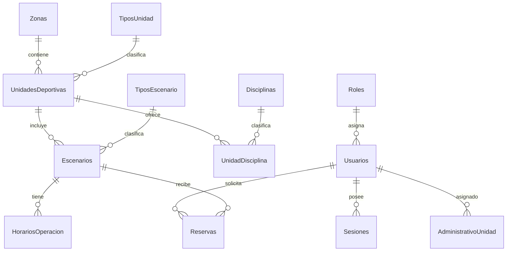

# Plan de implementacion del backend SGRED

## Alcance analizado

El backend cubre HU-01 a HU-03, HU-05 a HU-12, HU-14 a HU-17. HU-04, HU-10.2, HU-13, HU-18 y HU-19 quedan fuera y se marcan como puntos de extension.

## Arquitectura

Express organiza el proyecto en rutas, controladores, servicios, repositorios y base de datos. Los controladores solo traducen HTTP; los servicios aplican reglas; los repositorios contienen SQL parametrizado. SQL Server se administra mediante migraciones numeradas e idempotentes.

## Modelo de datos

## Contratos principales

- POST /api/v1/auth/registro
- POST /api/v1/auth/login
- POST /api/v1/auth/logout
- GET /api/v1/auth/sesion
- POST /api/v1/auth/renovar
- GET/PUT /api/v1/perfil
- POST /api/v1/admin/personal
- POST /api/v1/auth/definir-password
- GET /api/v1/unidades
- GET /api/v1/unidades/:id
- GET /api/v1/escenarios
- GET /api/v1/escenarios/:id/disponibilidad
- GET /api/v1/catalogos/:tipo
- POST /api/v1/reservas
- GET /api/v1/reservas/mias
- GET /api/v1/reservas/mias/:id
- GET /api/v1/admin/solicitudes
- GET /api/v1/admin/solicitudes/:id
- POST /api/v1/admin/solicitudes/:id/aprobar
- POST /api/v1/admin/solicitudes/:id/rechazar
- GET/POST/PUT/PATCH /api/v1/admin/escenarios
- POST /api/v1/analitica/eventos

## Integracion frontend

La interfaz actual usa vistas locales y datos simulados en App.tsx. Se analizara sin redisenarla. Se agrega src/services/api.ts con URL base, token, manejo 401 y mensajes. Los textos literales se alinearan con los criterios. Las pantallas de recuperacion, cancelacion y horario/bloqueo no se conectaran funcionalmente.

## Requisitos y decisiones

- SQL Server 2019+; ninguna consulta utiliza interpolacion.
- BCrypt costo 12 y JWT asociado a una Sesion registrada.
- Luxon con America/Bogota.
- Reservas concurrentes protegidas con transaccion READ COMMITTED y UPDLOCK/HOLDLOCK.
- Correo SMTP configurable y transporte de consola en desarrollo.
- CAPTCHa queda como punto de extension sin implementarlo.
